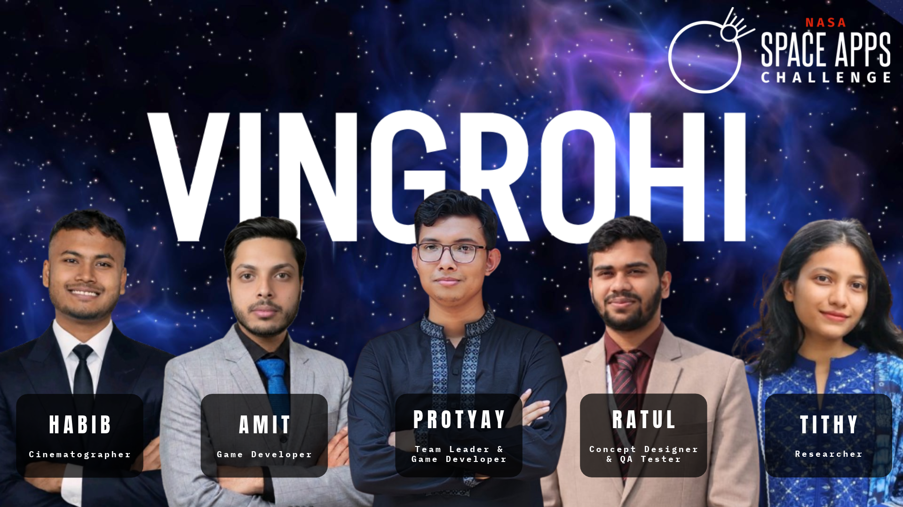

# Planet Red

A Junior Astronaut Mission Trainer. An Interactive Mars Survival & Outpost Management Experience. Developed with Unity for NASA Space Apps Challenge 2026

  
  
  
  
  

---

## About the Team

**Team Vingrohi**

*A team of passionate individuals trying to make resource management and survival on a Martian outpost more tangible, fun, and accessible for young learners through our game.*

## About Planet Red

**Planet Red** is a first person Mars survival and mission training game developed in Unity by Team Vingrohi for NASA Space Apps Challenge 2026.

Players take on the role of a junior astronaut exploring the challenges of surviving and establishing a sustainable human presence on Mars. Their journey begins near a damaged spacecraft, where they encounter **Beacon**, a stationary AI assistant that serves as their mission guide.

Beacon introduces objectives, explains scientific concepts, and assigns survival tasks involving essential Martian resources and infrastructure, including oxygen production, water resources, food cultivation, and habitat development.

The game features **Moxie2**, a creative model inspired by NASA's Mars Oxygen In-Situ Resource Utilization Experiment (MOXIE), representing a conceptual next generation system for producing oxygen from the Martian atmosphere.

Drawing inspiration from actual space exploration research and technologies, Planet Red transforms complex scientific concepts into interactive experiences. Through exploration and problem solving, players gain an introduction to the engineering challenges involved in sustaining human life beyond Earth.

Our goal is to make space science more tangible and accessible, particularly for younger audiences, while encouraging curiosity about planetary exploration, engineering, and the future of human spaceflight.

## Key Features

### Beacon: Your Mission Guide

Beacon is a stationary AI assistant located near the damaged spacecraft. It serves as the player's primary guide, introducing objectives, explaining scientific concepts, and assigning survival missions.

### Moxie2: Oxygen Generation

Inspired by NASA's MOXIE experiment, Moxie2 represents a conceptual oxygen generation system designed around the idea of extracting oxygen from the carbon dioxide rich Martian atmosphere.

### Martian Agriculture

An enclosed greenhouse environment and modern crop beds introduce the concept of controlled food production on Mars. Players explore how agriculture could support a sustainable Martian outpost.

### Underground Water Ice Exploration

Water is essential for long term human survival on Mars. The project draws inspiration from scientific research into subsurface water ice, exploring the importance of locating and accessing potential underground water resources.

### Habitat Development

A sustainable Martian outpost requires infrastructure that can protect astronauts and support essential life functions. Planet Red introduces the importance of developing suitable habitats and managing essential resources.

---

## Scientific Foundation & Data Sources

Planet Red draws inspiration from scientific research, planetary exploration missions, and technologies developed by NASA and other space agencies.

The following references support the scientific concepts represented in the project.

### NASA Research & Missions

| Research | Relevance to Planet Red |
|---|---|
| [MOXIE Experiment](https://www.nasa.gov/missions/mars-2020-perseverance/perseverance-rover/nasas-oxygen-generating-experiment-moxie-completes-mars-mission/) | Oxygen production from Martian atmospheric CO₂ |
| [Subsurface Water Ice Mapping (SWIM)](https://science.nasa.gov/resource/swim-map-shows-subsurface-water-ice-on-mars/) | Identifying potential underground water ice deposits |
| [InSight SEIS Instruments](https://science.nasa.gov/mission/insight/science-instruments/) | Seismic exploration and investigation of Martian subsurface structures |
| [Radiation Measurements on Mars](https://science.nasa.gov/resource/radiation-measurements-on-mars/) | Understanding radiation exposure and astronaut safety |

### Additional Scientific Research

- [Water on Mars: Scientists Find Oceans of Water Deep Underground](https://news.berkeley.edu/2024/08/12/scientists-find-oceans-of-water-on-mars-its-just-too-deep-to-tap/) — Research based on seismic observations from NASA's InSight mission, investigating water deep within the Martian crust.

### Space Agency Research & Technologies

The project also draws inspiration from international space research, particularly technologies related to space agriculture, planetary exploration, and sustainable human habitation.

- [NASA: Growing Plants in Space](https://www.nasa.gov/humans-in-space/growing-plants-in-space/)
- [NASA: Advanced Plant Habitat](https://www.nasa.gov/mission/international-space-station/)
- [ESA: Mars Express](https://www.esa.int/Science_Exploration/Space_Science/Mars_Express)

*These resources serve as scientific references and inspiration. The in-game systems are creative interpretations and should not be confused with actual operational NASA technologies.*

---

## Project Information

| | |
|---|---|
| Project Name | Planet Red |
| Team | Vingrohi |
| Event | NASA Space Apps Challenge 2026 |
| Challenge | Build a Junior Astronaut Mission Trainer |
| Game Engine | Unity |
| Environment | 3D |
| Gameplay Perspective | First Person |

## Acknowledgements

We would like to acknowledge NASA, its Space Agency Partners, and the scientific communities whose research and technological achievements inspired Planet Red.

We are grateful to the NASA Space Apps Challenge for providing a platform where students, developers, researchers, and creative thinkers can explore real world scientific challenges through innovation and collaboration.

---

  <b>PLANET RED</b> 
  <i>Explore. Learn. Survive.</i> 
  Developed with curiosity by <b>Team Vingrohi</b>.

